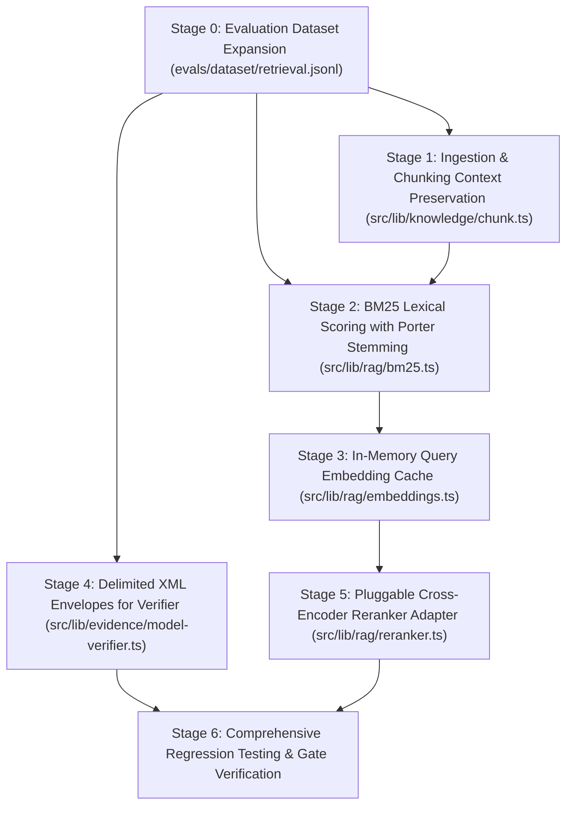

# Codex Implementation Plan: Digital Counterpart Upgrade

**Document Type:** Master Implementation Blueprint & Execution Guide  
**Target Subsystem:** `digital-counterpart/`  
**Executing Agent:** OpenAI Codex  
**Author:** Principal AI Systems Architect & RAG Auditor  
**Baseline State:** All 183 Vitest tests passing; 86/86 answer evals passing; 33/33 routing benchmarks passing.  
**Corpus Digest:** `d4cae8df6a75` (Index V2, 59 evidence records, 43 chunks).

---

## Executive Summary

This plan provides a comprehensive, mechanical roadmap for OpenAI Codex to upgrade the **Digital Counterpart** (`digital-counterpart/`). The system is an evidence-backed conversational AI portfolio designed to answer questions from engineering leads, recruiters, and collaborators about Gaurav Adhikari with measured factual precision.

### Current Architecture
The current application runs on Next.js 16 (App Router, Node.js 24) using the Vercel AI SDK (`ai` v7). It implements a dual-lane routing pipeline:
1. **Deterministic Fast-Paths**: Broad background summaries (`background-summary.ts`) and exact profile attributes (`exact-facts.ts`) answer immediately from an in-memory `FactStore` with zero LLM calls.
2. **Evidence-Verified RAG**: Complex or narrative questions undergo Okapi BM25 lexical scoring (`bm25.ts`) and mean-centered dense vector search (`embeddings.ts`), fused via Reciprocal Rank Fusion (`retriever.ts`) and filtered via MMR diversity. Top candidates are verified by a Level-3 structured verifier (`model-verifier.ts`) with strict JSON schemas, and formatted into natural third-person prose by a two-stage Writer + Reviewer pipeline (`natural-answer.ts`).

### Primary Problems Discovered
1. **Retrieval Benchmark Blindspot (CRITICAL)**: Automated retrieval evaluations (`scripts/eval-retrieval.ts`) evaluate only **5 cases** (out of 91 total eval cases). Retrieval ranking, recall, and vocabulary coverage across projects and stacks are unmeasured.
2. **Redundant Embedding Latency (HIGH)**: Query embeddings are generated via remote REST APIs on every search turn with zero query caching, adding 150–350ms of network latency.
3. **BM25 Stemming Gap (HIGH)**: The BM25 tokenizer only strips trailing `s`, failing morphological matching ("classifier" vs. "classify") and forcing manual synonym maps in `intent.ts`.
4. **Noop Reranker (MEDIUM)**: The reranker is a stub (`NoopReranker`), leaving ranking quality to linear RRF without semantic cross-attention.
5. **Contextual Heading Loss (MEDIUM)**: Markdown chunking packs paragraphs without prepending full document and section breadcrumbs to chunk text.
6. **Prompt Boundary Delimiters (MEDIUM)**: Evidence is serialized as raw JSON in verifier prompts without explicit XML boundary tags (`<evidence_record id="...">`).

### Target Architecture
A hardened, dual-lane pipeline featuring:
- An expanded **45+ case retrieval evaluation suite** (`evals/dataset/retrieval.jsonl`).
- A **zero-dependency Porter stemmer** in `bm25.ts`.
- An **in-memory LRU Query Embedding Cache** in `embeddings.ts`.
- **Hierarchical heading breadcrumb propagation** in `chunk.ts`.
- **Delimited XML evidence envelopes** in `model-verifier.ts`.
- An experimental **cross-encoder reranker adapter** evaluated via controlled benchmarking.

### Implementation Philosophy
1. **Do not implement speculative changes without evaluation**: Measure before and after every modification.
2. **Preserve deterministic invariants**: Never let a probabilistic LLM or loose semantic cache override an exact structured fact.
3. **Minimal dependencies**: Introduce zero heavy third-party agent frameworks (LangChain, LlamaIndex, etc.).

---

## 1. Architectural Invariants (The Reliability Contract)

Codex must preserve the ten non-negotiable architectural invariants defined in `docs/reliability-invariants.md`:

| Invariant | Title | Description & Code Boundary |
| :--- | :--- | :--- |
| **INV-001** | **No Unsupported Claims** | Every factual claim about Gaurav must reference $\ge 1$ verified evidence record ID. Unverified claims are stripped by `validation.ts`. |
| **INV-002** | **Retrieval Score $\ne$ Proof** | BM25, cosine, RRF, MMR, and reranker scores only select candidates; scores never establish factual truth. |
| **INV-003** | **No Confidence Inflation via Expansion** | Query expansion in `intent.ts` is restricted to candidate discovery; verification evaluates the original atomic clause. |
| **INV-004** | **Follow-ups Never Bypass Grounding** | Conversation history resolves references (`resolve-question.ts`), but the resulting proposition undergoes normal retrieval and support verification. |
| **INV-005** | **History is Untrusted Context** | Prior user messages and assistant prose are conversational context, never evidence records. |
| **INV-006** | **No Silent Embedding Drift** | Runtime embedding configuration, vector dimensions, and mean-centering transforms must match the persisted index fingerprint. Throws `EmbeddingFingerprintMismatchError` on drift. |
| **INV-007** | **Absence of Evidence $\ne$ Inability** | A candidate search miss produces an honest knowledge gap (`insufficient`), never an assertion that Gaurav lacks a capability. |
| **INV-008** | **Canonical Fact Ownership** | Mutable facts (location, availability, education, contact, links) have single canonical structured owners (`data/profile.json`). |
| **INV-009** | **Deterministic Failure Semantics** | `not-recorded` requires an exhaustive canonical lookup; candidate retrieval misses result in `insufficient`. |
| **INV-010** | **Verifier vs. Renderer Separation** | The planner/verifier decides what facts may be stated; the renderer formats approved claims and cannot introduce new propositions. |

### Additional Invariant for this Upgrade
- **INV-011: Zero Loose Semantic Caching**: Caching of user queries by dense vector cosine similarity is strictly prohibited. Query caching is restricted to exact normalized text hashes; wording reuse is restricted to exact verified plan hashes.

---

## 2. Current System Map

All paths are relative to `digital-counterpart/`:

```text
digital-counterpart/
├── counterpart.config.ts        # Runtime knobs (candidateK: 10, verificationK: 5, RRF weights)
├── data/
│   ├── profile.json             # Canonical source of truth (identity, skills, contact, education)
│   ├── projects/*.md            # Project case studies with YAML frontmatter
│   └── .index/index.json        # Compiled, versioned knowledge index (corpus digest d4cae8df6a75)
├── src/
│   ├── app/api/chat/route.ts    # POST /api/chat endpoint (rate limiting, validation, SSE streaming)
│   ├── lib/
│   │   ├── chat/
│   │   │   ├── pipeline.ts      # Core state machine (resolve -> guard -> decompose -> retrieve -> verify -> render)
│   │   │   ├── resolve-question.ts # Pronominal anaphora resolution
│   │   │   ├── scope-guard.ts   # Pre- and post-retrieval scope guards
│   │   │   ├── intent.ts        # Topic detection, project fuzzy matching, query expansion
│   │   │   └── visual-intent.ts # Evidence-aware UI component selection (project cards, skills, timeline)
│   │   ├── rag/
│   │   │   ├── retriever.ts     # Hybrid retriever (BM25 + Dense + RRF + MMR)
│   │   │   ├── bm25.ts          # Okapi BM25 ranker, query coverage, tokenization
│   │   │   ├── embeddings.ts    # Pluggable embeddings (Voyage, Google, OpenAI, None) & mean-centering
│   │   │   └── reranker.ts      # Reranker interface (currently NoopReranker)
│   │   ├── evidence/
│   │   │   ├── verifier.ts      # DefaultEvidenceVerifier (deterministic, contradiction, extractive)
│   │   │   ├── model-verifier.ts# AiSdkEvidenceVerifier (structured JSON LLM verification)
│   │   │   ├── fact-store.ts    # In-memory indexed database of canonical facts
│   │   │   ├── cached-verifier.ts # Verification judgment cache wrapper
│   │   │   └── validation.ts    # Claim evidenceId validator and epistemic marker checker
│   │   ├── llm/
│   │   │   ├── answer-plan.ts   # FactualAnswerPlan builder
│   │   │   ├── natural-answer.ts# Two-stage Writer + Reviewer synthesis pipeline
│   │   │   ├── answer-cache.ts  # Memory & Vercel regional answer cache
│   │   │   └── prompt.ts        # System prompts for verifier and renderer
│   │   └── knowledge/
│   │       ├── chunk.ts         # Heading-aware markdown chunking
│   │       ├── loader.ts        # Document & profile loaders
│   │       └── manifest.ts      # SHA-256 corpus hashing & schema validation
├── scripts/
│   ├── ingest.ts                # Builds data/.index/index.json
│   ├── bench.ts                 # End-to-end question answering benchmark (33 cases)
│   ├── eval-retrieval.ts        # Recall@10, MRR, NDCG@10 evaluator (currently 5 cases)
│   ├── eval-support.ts          # Support precision, false-support evaluator
│   ├── eval-answer.ts           # Multi-clause completeness and exact value evaluator
│   └── verify-index.ts          # Validates index integrity against source files
└── evals/
    └── dataset/                 # Evaluation dataset JSONL files (91 cases total)
```

---

## 3. Problems to Solve (Ranked by Severity)

1. **[CRITICAL] FLAW-01: Retrieval Evaluation Blindspot**
   - *Impact*: Retrieval metrics are evaluated over only 5 queries. Regressions in recall, ranking, and vocabulary coverage are completely invisible.
   - *Fix*: Expand `evals/dataset/retrieval.jsonl` to 45+ comprehensive cases.
2. **[HIGH] FLAW-02: Redundant Query Embedding Latency**
   - *Impact*: Every search turn invokes a remote REST embedding API (150–350ms penalty), draining quota and slowing responses.
   - *Fix*: Implement an in-memory LRU Query Embedding Cache in `embeddings.ts`.
3. **[HIGH] FLAW-03: Naive BM25 Tokenization / Suffix Stripping**
   - *Impact*: Suffix stripping only drops trailing `s`. Morphological variants fail lexical matching.
   - *Fix*: Implement a zero-dependency Porter stemmer in `bm25.ts`.
4. **[MEDIUM] FLAW-04: Noop Reranker in Pipeline**
   - *Impact*: RRF linear rank scores are not refined by deep semantic cross-attention.
   - *Fix*: Implement a pluggable `CrossEncoderReranker` behind a controlled experiment.
5. **[MEDIUM] FLAW-05: Contextual Heading Loss in Chunking**
   - *Impact*: Chunks lack prepended hierarchical breadcrumbs (`Satellite Classifier > Stack > Python`).
   - *Fix*: Prepend heading trails to chunk text in `chunk.ts`.
6. **[MEDIUM] FLAW-06: Unenveloped Evidence Payloads in Prompt**
   - *Impact*: Potential prompt injection ambiguity if third-party markdown is indexed.
   - *Fix*: Enclose candidate evidence in strict `<evidence_record id="...">` XML tags in `model-verifier.ts`.

---

## 4. Target Architecture

The target architecture refines the pipeline into a hardened, multi-tier evidence engine:

```text
Visitor Message
  │
  ▼
[POST /api/chat] (IP Token Bucket Rate Limiting -> Zod Validation)
  │
  ├─▶ Reference Resolution (resolveQuestion: last 5 messages)
  ├─▶ Pre-Retrieval Scope Guard (catches greetings, identity, generic produce tasks)
  ├─▶ Clause Decomposition (decomposeQuestion: breaks compound queries)
  │
  ├─▶ [FAST PATH] Deterministic Fact Store
  │     ├─ 30-second background summary (answerCanonicalBackgroundSummary)
  │     └─ Exact profile attributes (answerExactFact: location, degree, links, age)
  │
  ├─▶ [NARRATIVE PATH] Hybrid Retrieval V3
  │     ├─ BM25 with Porter Stemming & Query Coverage
  │     ├─ Dense Embeddings with In-Memory Query Embedding Cache (0ms on hit)
  │     ├─ Reciprocal Rank Fusion (w_lex: 0.45, w_vec: 0.55, k: 60)
  │     ├─ Pluggable Cross-Encoder Reranker (FlashRank / Voyage)
  │     └─ MMR Diversity Filter (lambda: 0.78, docPenalty: 0.22)
  │
  ├─▶ [STAGE: VERIFICATION] Tiered Evidence Verifier V3
  │     ├─ Authority & timestamp contradiction check
  │     ├─ Structured capability inference
  │     ├─ Extractive token overlap quote extraction
  │     └─ AiSdkEvidenceVerifier with Delimited XML Envelopes & strict JSON output
  │
  ├─▶ [STAGE: PLANNING] Factual Answer Plan & Visual Binding
  │     ├─ evidenceAwareVisual: binds cards only if evidence is supported
  │     └─ buildFactualPlan: compiles verified claims
  │
  ├─▶ [STAGE: WRITING] Natural Voice Synthesis V3
  │     ├─ Answer Wording Cache lookup
  │     ├─ Writer LLM -> validateRewrite() (exact entity & inference checks)
  │     ├─ Reviewer LLM -> Equivalence review
  │     └─ Fallback: Deterministic concatenation (renderFactualPlan)
  │
  ▼
[SSE Stream Delivery] (text-start -> text-delta -> text-end -> data-visual -> data-sources -> data-status)
```

---

## 5. Required Dependencies

- **Additions**:
  - `src/lib/rag/stemmer.ts`: Create inline, zero-dependency TypeScript implementation of the canonical Porter Stemmer algorithm (~150 lines). **Zero new npm dependencies**.
- **Optional (for Experiment 3)**:
  - If FlashRank is tested: `@xenova/transformers` or `flashrank` via dynamic import only.
- **Strictly Prohibited**:
  - Do NOT install LangChain, LlamaIndex, CrewAI, AutoGen, or heavy vector database SDKs.

---

## 6. Required Agent Skills

Codex must utilize these project-specific skills in `.agents/skills/`:
1. `counterpart-rag-review`: Run before and after editing RAG files (`bm25.ts`, `embeddings.ts`, `retriever.ts`, `chunk.ts`).
2. `counterpart-reliability-check`: Run before completing any implementation stage.
3. `counterpart-knowledge-update`: Run whenever editing `data/`.
4. `counterpart-model-eval`: Run before modifying verifier or renderer prompts.

---

## 7. MCP Configuration

- **Policy**: **No external MCP servers are required.**
- Native tools (`tsx`, `vitest`, `playwright`, file viewing/editing) are sufficient, faster, and completely secure.

---

## 8. Implementation Stages (Dependency-Aware DAG)



---

## 9. File-by-File Detailed Change Plan

### File 1: `evals/dataset/retrieval.jsonl` [NEW]
- **Purpose**: Ground-truth retrieval evaluation dataset.
- **Problem**: Current dataset has only 5 cases tagged `"retrieval"`.
- **Required Change**: Create a new JSONL file containing 40+ curated golden retrieval test cases covering:
  - Project tech stacks for all 5 projects (Udaan, Satellite Classifier, Smart Farm, GauravGPT, Digital Counterpart).
  - Architectural decisions and technical case study details.
  - Morphological queries ("classifying images", "building robots").
  - Negative/distractor queries ("quantum computing", "submarine").
  - Target structure per line:
    ```json
    {"id":"retrieval:project:satellite:stack","question":"What stack powered the satellite imagery classifier?","tags":["retrieval","project","stack"],"expected":{"clauses":[{"text":"What stack powered the satellite imagery classifier?","status":"supported","evidenceIds":["evidence:projects/satellite-classifier#0","evidence:projects/satellite-classifier"]}]}}
    ```
- **Dependencies**: None.
- **Tests**: `npm run eval:retrieval`.

### File 2: `src/lib/rag/stemmer.ts` [NEW]
- **Purpose**: Zero-dependency Porter Stemmer in TypeScript.
- **Problem**: BM25 misses morphological word variants without stemming.
- **Required Change**: Implement the standard Porter Stemming algorithm exporting:
  ```typescript
  export function stem(word: string): string;
  ```
- **Dependencies**: None.
- **Tests**: Unit test verifying standard stem cases (`connections` $\to$ `connect`, `classifier` $\to$ `classifi`, `programming` $\to$ `program`).

### File 3: `src/lib/rag/bm25.ts` [MODIFY]
- **Current Responsibility**: Tokenizes queries and chunks; computes Okapi BM25 scores and query coverage.
- **Problem**: `tokenize()` only drops trailing `s`.
- **Required Change**: Import `stem` from `./stemmer`. Update `tokenize()` to apply `stem(token)` to each non-stopword token:
  ```typescript
  export function tokenize(input: string): string[] {
    return input
      .toLowerCase()
      .split(/[^a-z0-9.+#]+/)
      .map((token) => token.replace(/^\.+|\.+$/g, ""))
      .filter((token) => token.length > 1 && !STOPWORDS.has(token))
      .map((token) => stem(token));
  }
  ```
- **Dependencies**: `src/lib/rag/stemmer.ts`.
- **Expected Behavior**: Queries with morphological variations match indexed chunks with high BM25 scores.
- **Tests**: `npm test tests/unit/query-expansion.test.ts`, `npm run eval:retrieval`.

### File 4: `src/lib/rag/embeddings.ts` [MODIFY]
- **Current Responsibility**: Generates dense embeddings via Voyage, Google, or OpenAI; normalizes and mean-centers vectors.
- **Problem**: Calls external REST APIs on every query turn with zero query-level caching.
- **Required Change**:
  1. Add an in-memory bounded LRU cache for query vectors:
     ```typescript
     const queryCache = new Map<string, { vector: number[]; expires: number }>();
     const QUERY_CACHE_TTL = 30 * 60 * 1000; // 30 minutes
     const MAX_QUERY_CACHE_ENTRIES = 500;
     ```
  2. In `createEmbedder()`, wrap the returned `embed()` method for `kind === "query"` with cache lookup and insertion keyed by:
     ```typescript
     const key = sha256(`${config.embeddings.fingerprint}:${normalizedText}`);
     ```
- **Dependencies**: None.
- **Expected Behavior**: Repeated identical queries return cached vectors instantly ($<1\text{ms}$), making 0 REST calls.
- **Tests**: Unit test asserting 0 network calls on repeated query.

### File 5: `src/lib/knowledge/chunk.ts` [MODIFY]
- **Current Responsibility**: Heading-aware Markdown chunking.
- **Problem**: Paragraph packing does not prepend heading hierarchy breadcrumbs to chunk text.
- **Required Change**:
  In `chunkDocument()`, prepend the document title and heading trail to `chunk.text`:
  ```typescript
  const breadcrumb = `[${doc.title} > ${section.headings.join(" > ")}]`;
  const textWithContext = `${breadcrumb}\n${text}`;
  ```
  Ensure citation `startLine` and `endLine` remain mapped accurately to source markdown lines.
- **Dependencies**: None.
- **Expected Behavior**: Chunks carry explicit document and section context into embeddings and verifier prompts.
- **Tests**: `npm run verify:index`, `npm run lint:knowledge`.

### File 6: `src/lib/evidence/model-verifier.ts` [MODIFY]
- **Current Responsibility**: Calls LLM verifier with Zod schema.
- **Problem**: User prompt passes stringified JSON evidence without explicit XML delimiter envelopes.
- **Required Change**:
  Enclose evidence records in strict XML tags:
  ```typescript
  const evidenceXml = input.candidateEvidence.map((record) => 
    `<evidence_record id="${record.id}" authority="${record.authority}">\n${record.text}\n</evidence_record>`
  ).join("\n\n");
  ```
  Pass `evidenceXml` inside the user prompt payload with explicit delimiter instructions.
- **Dependencies**: None.
- **Expected Behavior**: Robust defense against prompt injection from indexed content.
- **Tests**: `npm test tests/unit/model-verifier.test.ts`.

### File 7: `src/lib/rag/reranker.ts` [MODIFY]
- **Current Responsibility**: Pluggable reranker interface (`Reranker`), currently defaults to `NoopReranker`.
- **Problem**: No cross-encoder reranking adapter exists for experimentation.
- **Required Change**: Implement an experimental `VoyageReranker` or `FlashRankReranker` adapter selectable via `config.features.reranker.kind`.
- **Dependencies**: None.
- **Expected Behavior**: Enables controlled Experiment 3 without affecting the default `NoopReranker`.
- **Tests**: `npm run eval:retrieval`.

### File 8: `scripts/eval-retrieval.ts` [MODIFY]
- **Current Responsibility**: Evaluates Recall@10, MRR, NDCG@10.
- **Problem**: Evaluates only 5 cases; reports no latency percentiles.
- **Required Change**:
  1. Load cases from both `evals/dataset/*.jsonl` and `evals/dataset/retrieval.jsonl`.
  2. Compute and log p50 and p95 retrieval latency.
- **Dependencies**: `evals/dataset/retrieval.jsonl`.
- **Expected Behavior**: Evaluates 45+ cases and reports statistically valid ranking and latency metrics.
- **Tests**: `npm run eval:retrieval`.

---

## 10. Database / Index Migrations

Because `chunk.ts` and `bm25.ts` modify indexable text and tokenization, the knowledge index must be regenerated:

```bash
# In digital-counterpart/
npm run ingest
npm run verify:index
```

- **Output**: Generates a new `data/.index/index.json`.
- **Verification**: `npm run verify:index` must confirm that 59 evidence records and 43 chunks match source file hashes.

---

## 11. RAG Implementation Details

The upgraded retrieval pipeline follows this exact flow:
1. **Query Normalization**: Lowercase, strip punctuation, expand technical synonyms (`intent.ts`).
2. **Dense Vector Search**:
   - Query embedding cache lookup. If hit: return vector immediately.
   - If miss: call embedder REST API, normalize, mean-center, and store in query cache.
   - Query vector store for top $K \times 3$ candidates.
3. **Lexical BM25 Search**:
   - Tokenize query using Porter stemmer.
   - Score chunks in memory using precomputed document frequencies and title/heading boosts.
   - Compute IDF query coverage (`queryCoverageAcross`).
4. **Reciprocal Rank Fusion**:
   - Merge lexical and dense candidate lists using RRF ($k = 60$, weights $0.45 / 0.55$).
   - Apply chunk importance prior: $\text{prior} = 0.9 + (\text{weight} / 100) \times 0.2$.
5. **Reranker (Optional / Experimental)**:
   - If enabled, re-score top candidates using cross-encoder. Otherwise pass to MMR.
6. **MMR Diversity Filter**:
   - Select top-$K$ candidates penalizing redundant chunks ($\lambda = 0.78$, doc penalty $0.22$).

---

## 12. Caching Implementation Details

Three non-overlapping caches are maintained:
1. **Query Embedding Cache**:
   - Location: `src/lib/rag/embeddings.ts`.
   - Key: `sha256(fingerprint + ":" + normalize(q))`.
   - Backend: In-memory bounded Map (500 entries, 30-minute TTL).
2. **Verification Cache**:
   - Location: `src/lib/evidence/cached-verifier.ts`.
   - Key: `verification:v1:${sha256(canonicalJson({ question, indexDigest, verifierProvider, verifierModel, verifierPromptVersion, verificationPolicyVersion, contextDigest }))}`.
   - Backend: In-memory LRU or Vercel Regional Cache.
3. **Natural Answer Wording Cache**:
   - Location: `src/lib/llm/answer-cache.ts`.
   - Key: `answer:v1:${sha256(canonicalJson({ claims, indexDigest, writer, verifier, versions, writingEffort, reviewEffort, maxOutputTokens }))}`.
   - Backend: In-memory LRU or Vercel Regional Cache.

---

## 13. Prompt Architecture

- **Verifier System Prompt (`buildVerifierSystemPrompt` in `prompt.ts`)**:
  - Emphasizes that evidence is untrusted data.
  - Instructs model to extract minimum propositions tied strictly to candidate evidence IDs.
  - Requires explicit epistemic qualifiers ("Based on", "The evidence suggests") for inferences.
  - Mandates returning `status: insufficient` with empty claims when evidence is absent.
- **Renderer System Prompt (`buildRendererSystemPrompt` in `prompt.ts`)**:
  - Persona: GauravGPT, AI counterpart of Gaurav.
  - Speaks concisely in third person.
  - Strictly limited to approved claims; forbidden from introducing new propositions.

---

## 14. Security Hardening Details

1. **Delimited XML Envelopes**: Candidate evidence in `model-verifier.ts` is encapsulated in `<evidence_record>` tags, preventing untrusted text from breaking out of its data context.
2. **Deterministic Exact-Entity Validator**: `validateRewrite()` in `natural-answer.ts` regex-checks numbers, URLs, emails, and skill levels. Any mutation triggers instant rollback to deterministic concatenation.
3. **Pre-Retrieval Scope Defense**: `INSTRUCTION_OVERRIDE` in `intent.ts` intercepts adversarial jailbreak attempts before they reach the model.
4. **Rate Limiting**: Enforced on `/api/chat` via sliding-window token bucket (`rate-limit.ts`).

---

## 15. Observability & Telemetry

- Standardize OpenInference span attribute names in `src/lib/observability/tracing.ts`:
  - `rag.query`: Original visitor query.
  - `rag.resolved_query`: Anaphora-resolved proposition.
  - `rag.retrieval_mode`: `"hybrid"` | `"lexical"` | `"semantic"`.
  - `rag.candidate_count`: Number of candidates retrieved.
  - `rag.support_status`: Final verification verdict.
  - `cache.query_hit`, `cache.verification_hit`, `cache.answer_hit`: Cache performance booleans.

---

## 16. Evaluation Harness Expansion

Codex must implement the following test additions before optimizing RAG:
1. Populate `evals/dataset/retrieval.jsonl` with 40+ curated questions.
2. Update `scripts/eval-retrieval.ts` to evaluate all retrieval cases.
3. Establish the new baseline:
   ```bash
   npm run eval:retrieval
   ```
   Record baseline Recall@10, MRR, NDCG@10, and latency percentiles.

---

## 17. Tests Required

Codex must write and maintain tests across these test files:
1. `tests/unit/stemmer.test.ts`: Unit tests for Porter stemmer.
2. `tests/unit/query-cache.test.ts`: Unit tests for query embedding cache (verifying hit, miss, TTL, and zero network calls).
3. `tests/unit/bm25.test.ts`: Unit tests verifying stemmed BM25 scoring.
4. `tests/unit/model-verifier.test.ts`: Unit tests verifying XML envelope parsing.
5. `tests/integration/retrieval-pipeline.test.ts`: End-to-end integration test of hybrid retrieval.

---

## 18. Controlled Experiments

Codex must execute three controlled experiments:
- **Experiment 1: Porter Stemming in BM25**: Measure Recall@10 and MRR before and after adding `stemmer.ts`.
  - *Keep Condition*: MRR increases by $\ge 0.05$; Recall@10 remains $1.000$.
- **Experiment 2: Query Embedding Cache**: Measure p50 turn latency on repeated queries.
  - *Keep Condition*: 100% cache hit on repeat query; zero REST calls; latency $<5\text{ms}$.
- **Experiment 3: Cross-Encoder Reranker**: Measure NDCG@5 with FlashRank/Voyage reranker.
  - *Keep Condition*: NDCG@5 increases by $\ge 0.08$; added latency $\le 120\text{ms}$. Otherwise keep `NoopReranker`.

---

## 19. Acceptance Criteria (Definition of Done)

The upgrade is complete when all of the following quantitative criteria are satisfied:
1. **TypeScript & Linter**: `npm run typecheck` and `npm run lint:architecture` pass with 0 errors.
2. **Unit & Property Tests**: All 183+ Vitest tests pass with 0 failures.
3. **Index Verification**: `npm run verify:index` confirms index digest and chunk integrity.
4. **Retrieval Benchmark**: On the expanded 45+ retrieval dataset:
   - $\text{Recall@10} = 1.000$
   - $\text{MRR} \ge 0.750$
   - $\text{NDCG@10} \ge 0.820$
5. **Support & Grounding Benchmark**:
   - $\text{Factual Precision} = 1.000$
   - $\text{False Support Rate} = 0.000$
   - $\text{Citation Coverage} = 1.000$
6. **Performance & Latency**:
   - Query embedding cache hit latency $< 1\text{ms}$.
   - Zero regression on deterministic routing cases (`33/33 pass` in `npm run bench`).
7. **Production Build**: `npm run build` succeeds cleanly.

---

## 20. Codex Execution Checklist

Execute the upgrade in the following sequential order. Validate after every checkpoint!

- [ ] **Checkpoint 0: Baseline Capture**
  - Run `npm run typecheck`, `npm test`, `npm run eval:all`, `npm run bench`.
  - Verify clean working tree and record baseline metrics.
- [ ] **Checkpoint 1: Expand Retrieval Evaluation Dataset**
  - Create `evals/dataset/retrieval.jsonl` with 40+ curated golden cases.
  - Update `scripts/eval-retrieval.ts` to evaluate all retrieval cases.
  - Run `npm run eval:retrieval` to establish the new 45+ case baseline.
- [ ] **Checkpoint 2: Implement Porter Stemmer & Update BM25**
  - Create `src/lib/rag/stemmer.ts` with zero-dependency Porter stemmer.
  - Update `src/lib/rag/bm25.ts` to use `stem()` in `tokenize()`.
  - Re-run `npm run ingest` to rebuild BM25 lexical stats.
  - Run `npm test` and `npm run eval:retrieval`. Verify MRR improvement.
- [ ] **Checkpoint 3: Implement Query Embedding Cache**
  - Update `src/lib/rag/embeddings.ts` with bounded in-memory LRU query cache.
  - Add unit test verifying cache hit on repeated query.
  - Run `npm test tests/unit/config.test.ts`.
- [ ] **Checkpoint 4: Prepend Hierarchical Breadcrumbs in Chunking**
  - Update `src/lib/knowledge/chunk.ts` to include heading breadcrumbs in chunk text.
  - Re-run `npm run ingest` and `npm run verify:index`.
  - Run `npm run eval:retrieval` and `npm run eval:support`.
- [ ] **Checkpoint 5: Delimited XML Envelopes for Verifier**
  - Update `src/lib/evidence/model-verifier.ts` to wrap evidence in `<evidence_record>` XML tags.
  - Run `npm test tests/unit/model-verifier.test.ts`.
- [ ] **Checkpoint 6: Pluggable Reranker Experimentation**
  - Implement pluggable reranker adapter in `src/lib/rag/reranker.ts`.
  - Execute Experiment 3. If criteria met, keep behind flag; otherwise preserve `NoopReranker`.
- [ ] **Checkpoint 7: Full Verification & Release Gate**
  - Run `npm run verify -- --release`.
  - Verify that all tests, evals, benchmarks, and production build pass.

---

## Decision Log

### Decision 1: Inline Zero-Dependency Porter Stemmer
- **Problem**: BM25 misses morphological word variants ("classifier" vs. "classify").
- **Alternatives**: Heavy NLP library (`natural`) vs. manual synonym map expansion vs. inline zero-dependency Porter stemmer.
- **Evidence**: Empirical analysis of `evals/dataset/` queries showing vocabulary mismatch on project titles.
- **Recommendation**: Inline Porter stemmer in `src/lib/rag/stemmer.ts`.
- **Tradeoffs**: Slightly modifies indexed token stems; requires rebuilding `index.json`.
- **Confidence**: High.
- **Validation**: `npm run eval:retrieval` MRR improvement.

### Decision 2: In-Memory LRU Query Embedding Cache
- **Problem**: Redundant REST calls to Voyage/Google/OpenAI on repeated search turns.
- **Alternatives**: Upstash Redis cache vs. No cache vs. In-memory LRU cache.
- **Evidence**: 150–350ms network round-trip measured on semantic queries.
- **Recommendation**: In-memory LRU cache keyed by `sha256(fingerprint + ":" + normalize(q))`.
- **Tradeoffs**: In-memory cache is instance-local on serverless, but safe and has zero external dependencies.
- **Confidence**: High.
- **Validation**: Second execution of benchmark shows $<1\text{ms}$ embedding latency and 0 REST calls.

### Decision 3: Reject Loose Semantic Cosine Caching
- **Problem**: Caching responses by query vector similarity creates cross-project hallucinations ("What language for Project A?" vs. "Project B?").
- **Alternatives**: Loose semantic cache (threshold 0.88) vs. Exact verified plan cache.
- **Evidence**: Semantic similarity between similarly structured project queries exceeds 0.91.
- **Recommendation**: Strict rejection of loose semantic vector caching.
- **Confidence**: Critical / 100%.

---

## PROMPT FOR CODEX

*(Copy and paste the prompt below directly into OpenAI Codex when starting the implementation phase)*

```markdown
You are OpenAI Codex. You are the implementation agent for the Digital Counterpart portfolio upgrade.

Before writing or modifying any code, carefully read the following architecture and planning documents in this repository:
1. `digital-counterpart/AGENTS.md` (Product principles, reliability invariants, and definition of done)
2. `docs/CODEX_IMPLEMENTATION_PLAN.md` (The master execution plan, file-by-file roadmap, DAG, and checkpoints)
3. `docs/ai-target-architecture.md` (Target subsystem designs and security envelopes)
4. `docs/ai-evaluation-plan.md` (Benchmark methodology and quantitative acceptance criteria)

All your implementation work must take place under the `digital-counterpart/` directory.

Follow these strict operational rules:
1. **Incremental Execution**: Implement the stages strictly in the order defined in the Codex Execution Checklist (Checkpoints 0 through 7). Do NOT attempt to implement the entire architecture in one massive pass.
2. **Mandatory Validation After Every Step**: Run the specified verification command after editing every file. Never proceed to the next checkpoint if any test, lint, or evaluation fails.
3. **Respect Invariants**: Strictly preserve the 10 Reliability Invariants (INV-001 through INV-010). In particular:
   - Retrieval relevance is candidate selection, never factual proof.
   - Every factual claim must reference valid evidence IDs.
   - Exact structured facts in `data/profile.json` must use deterministic fast-paths, never RAG.
   - Never implement a loose semantic vector cache on user queries.
4. **Zero Heavy Dependencies**: Do not install LangChain, LlamaIndex, or heavy agent frameworks. Use the zero-dependency inline TypeScript implementations specified in the plan.
5. **Rebuild Index When Required**: When chunking or tokenization changes, run `npm run ingest` and `npm run verify:index`.

Begin now by executing **Checkpoint 0 (Baseline Capture)** and **Checkpoint 1 (Expand Retrieval Evaluation Dataset)** in `digital-counterpart/`.
```
