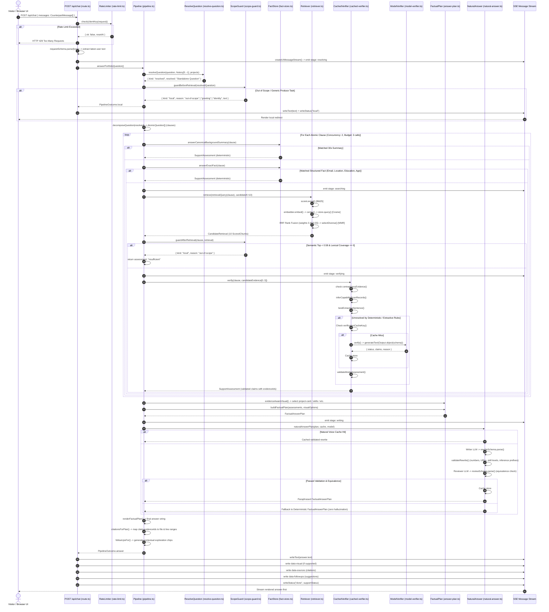

# Digital Counterpart AI System Audit & Architecture Forensic Report

**Document Status:** Complete Architecture Audit  
**Target Subsystem:** `digital-counterpart/`  
**Auditor:** Principal AI Systems Architect & Security Reviewer  
**Audience:** OpenAI Codex Implementation Engineers  
**Corpus Digest Baseline:** `d4cae8df6a75` (Index V2, 59 evidence records, 43 chunks)  
**Verification Baseline:** All 183 unit/property/integration tests passing; 86/86 answer evals; 33/33 routing benchmarks passing.

---

## 1. Executive Forensic Summary

The **Digital Counterpart** (`digital-counterpart/`) is a specialized conversational twin engineered to represent Gaurav Adhikari to recruiters, engineering leads, and technical collaborators. Rather than an unconstrained general-purpose chatbot, the codebase implements an **Evidence Pipeline** where factual statements must be grounded in authored evidence records (`data/profile.json` and `data/projects/*.md`).

The architecture has advanced beyond naive vector search: it incorporates dual-lane routing (deterministic canonical fact fast-paths vs. narrative candidate retrieval), an in-memory Okapi BM25 ranker, pluggable embeddings with mean-centering, Reciprocal Rank Fusion (RRF), Maximal Marginal Relevance (MMR) diversity filtering, structured Level-3 LLM claim verification with strict JSON schemas, and a two-stage Writer + Reviewer natural voice synthesis pipeline with exact value invariance checks.

However, a thorough architectural and security audit reveals **critical and high-priority flaws**:
1. **Critical Evaluation Blindspot**: The automated retrieval benchmark (`scripts/eval-retrieval.ts`) evaluates only **5 test queries** out of 91 total eval cases. This creates dangerous false confidence in ranking quality, recall, and vocabulary coverage.
2. **Redundant Embedding Latency & Quota Drain**: The query embedding step at `src/lib/rag/retriever.ts` has zero query-level caching, forcing repeated external REST API calls (150–350ms network round-trip) for identical or frequent questions.
3. **Lexical Stemming Deficit**: The BM25 tokenizer (`src/lib/rag/bm25.ts`) uses crude suffix stripping (dropping trailing `s`), causing morphological query misses ("classifier" vs. "classify", "building" vs. "build") that force manual synonym maintenance in `src/lib/chat/intent.ts`.
4. **No Active Reranker**: The reranker interface (`src/lib/rag/reranker.ts`) is a no-op stub (`NoopReranker`), leaving ranking quality vulnerable to linear rank fusion score saturation without deep semantic cross-attention.
5. **Contextual Heading Loss in Chunking**: Fixed-size character paragraph packing (`src/lib/knowledge/chunk.ts`) does not propagate full section hierarchy breadcrumbs into chunk bodies.
6. **Prompt Injection Boundary Hardening**: Evidence payloads sent to `AiSdkEvidenceVerifier` are formatted as JSON strings without explicit XML delimiter tags (`<evidence_record id="...">`), creating potential boundary ambiguity for untrusted text.

---

## 2. Technology Stack & Manifest Audit

The product directory is `digital-counterpart/`. The root package manifest defines the runtime environment:

| Layer | Component | Version / Specification | Architectural Role & Runtime Characteristics |
| :--- | :--- | :--- | :--- |
| **Framework** | Next.js | `^16.3.1` | App Router, React Server Components, Node.js 24 runtime, Edge-compatible API routes (`export const runtime = "nodejs"`). |
| **UI Library** | React & React DOM | `^19.2.8` | Server/Client components, Concurrent mode, selective hydration, answer-first reveal. |
| **Styling** | Tailwind CSS | `^4.1.13` (via `@tailwindcss/postcss`) | Utility-first styling, CSS custom properties, zero-runtime overhead. |
| **Motion** | Framer Motion | `^12.23.0` | Interruptible micro-interactions, layout transitions, reduced-motion compliant. |
| **AI Protocol** | Vercel AI SDK (`ai`) | `^7.0.66` | Server-Sent Events (SSE) UI message stream protocol (`createUIMessageStreamResponse`). |
| **Model Providers** | `@ai-sdk/openai` | `^4.0.42` | OpenAI GPT-5.6 / GPT-4.1 integration (primary verifier & renderer). |
| | `@ai-sdk/google` | `^4.0.44` | Google Gemini 3.5 Flash-Lite integration (fallback verifier). |
| | `@ai-sdk/azure` | `^4.0.61` | Azure OpenAI enterprise deployment adapter. |
| | `@ai-sdk/anthropic`| `^4.0.39` | Claude 3.5 Sonnet / Haiku integration adapter. |
| **Validation** | Zod | `^3.25.76` | Runtime contract validation for API bodies, configs, and structured model outputs. |
| **Document Parser**| Gray-Matter | `^4.0.3` | YAML frontmatter parsing for markdown case studies. |
| **Observability** | OpenTelemetry API | `^1.9.1` | Manual tracing via `src/lib/observability/tracing.ts`. |
| **Testing** | Vitest | `^5.0.0` | In-memory unit, property, and integration test execution. |
| | Fast-Check | `^4.9.0` | Property-based fuzzing of pipeline and claim invariants. |
| | Playwright | `^1.62.1` | End-to-end browser fixture testing (desktop and mobile viewports). |

---

## 3. End-to-End Request Lifecycle & Trace

The following trace details every function, file, and data transformation from visitor query submission to the final SSE event.

---

## 4. Deep Forensic Audit by Subsystem

### 4.1. Ingestion Pipeline (`scripts/ingest.ts`)
- **File & Role**: `scripts/ingest.ts` parses `data/`, removes authoring placeholders, splits documents into chunks, generates embeddings, builds BM25 lexical stats, and serializes `data/.index/index.json`.
- **Integrity Mechanisms**:
  - `corpusDigest`: SHA-256 hash across all file paths and their contents (`buildSourceManifest`).
  - `containsAuthoringPlaceholder`: Strips lines with `TODO`, `FIXME`, HTML comments, and `{{...}}` template markers before indexing.
  - `assertCurrentSources`: Validates during runtime startup that source file hashes on disk match `index.json`.
- **Identified Flaws**:
  - **No Incremental Ingest**: Ingestion is all-or-nothing. On large corpora, re-embedding all chunks is costly. (Current corpus is 43 chunks, so runtime is ~2.8s, but architecture lacks change-delta chunking).
  - **Hard-coded Character Chunking**: `chunkAll` passes `size: 900` characters and `overlap: 150` characters without token-boundary checking.

### 4.2. Chunking & Context Preservation (`src/lib/knowledge/chunk.ts`)
- **File & Role**: Heading-aware Markdown chunking. Splits on headings (`#`, `##`, `###`), collects paragraphs into character windows.
- **Identified Flaws**:
  - **Loss of Parent Breadcrumbs in Plain Text**: While chunks preserve a `headings: string[]` array in metadata, the `chunk.text` passed to vector embedders and verifiers does not prepend the hierarchical breadcrumb (e.g., `Satellite Classifier > Stack > Python`).
  - **Sub-bullet Truncation**: When an oversized paragraph or list exceeds 900 characters, it is hard-split with `slice(i, i + size)`, potentially severing a list item mid-sentence without boundary repair.

### 4.3. Dual-Index Retrieval Engine (`src/lib/rag/`)
- **Files**: `src/lib/rag/retriever.ts`, `src/lib/rag/bm25.ts`, `src/lib/rag/embeddings.ts`, `src/lib/rag/reranker.ts`.
- **BM25 Lexical Scorer**:
  - Okapi BM25 implementation with $k_1 = 1.5, b = 0.75$.
  - Includes `TITLE_BOOST = 2` and `HEADING_BOOST = 3` applied via repetition in `indexableText()`.
  - Computes `queryCoverageAcross()` to measure what fraction of IDF-weighted query terms are covered across candidate chunks.
  - **Critical Weakness**: Tokenizer performs lowercasing and crude suffix stripping (`endsWidth("s") ? slice(0, -1) : token`). No Porter/Snowball stemming. Technical search queries like "classifying satellite data" fail to match "satellite classifier" via BM25 alone.
- **Dense Semantic Embeddings**:
  - Supports Google (`text-embedding-004` or `gemini-embedding-exp-03-07`), Voyage (`voyage-3-lite` or `voyage-3`), OpenAI (`text-embedding-3-small`), and `none`.
  - Vectors are $L_2$-normalized.
  - Applies **mean-centering** (`center(vector, mean)`): subtracts the corpus mean vector to spread out dense cosine similarities across the [0.0, 1.0] range, eliminating high-density clustering on small personal corpora.
  - **Critical Weakness**: Query embeddings are computed on the fly on every turn without an in-memory or redis query embedding cache.
- **Rank Fusion & Diversity**:
  - Uses Reciprocal Rank Fusion: $\text{score} = \sum_{m} \frac{w_m}{k + \text{rank}_m(d)}$ with $k = 60$.
  - Applies MMR diversity selection to penalize chunks sharing tokens or originating from the same `docId` (`redundancy` penalty of 0.22).
  - **Weakness**: Reranker is completely disabled (`NoopReranker`).

### 4.4. Canonical Fact Store & Exact Paths (`src/lib/evidence/`)
- **Files**: `src/lib/evidence/fact-store.ts`, `src/lib/evidence/exact-facts.ts`, `src/lib/evidence/background-summary.ts`.
- **Strengths**:
  - Canonical facts (age, location, university, GPA, GitHub, LinkedIn, email, resume) are extracted into an in-memory typed database (`FactStore`) on startup.
  - Queries matching canonical patterns bypass RAG and LLM calls completely, returning `status: supported` with authority `authoritative`.
  - Contradiction resolution groups records by `subject + predicate`, prioritizing authoritative sources over derived ones and newer timestamps over older ones.
- **Weakness**:
  - Exact fact matching logic in `exact-facts.ts` relies on regex sets. If a visitor asks "What town does Gaurav reside in?", and the regex expects "where does he live|location|based in", it falls through to candidate retrieval.

### 4.5. Evidence Verification Engine (`src/lib/evidence/verifier.ts`, `model-verifier.ts`)
- **Files**: `src/lib/evidence/verifier.ts`, `model-verifier.ts`, `validation.ts`.
- **Model Verifier Design**:
  - Uses `AiSdkEvidenceVerifier` executing `generateText` with `Output.object({ schema: modelAssessmentSchema })`.
  - Strict JSON schema forces model to emit `status: enum`, `claims: [{ proposition, kind, evidenceIds }]`, `reason: string | null`.
  - `validateModelAssessment`: Enforces that every emitted claim references at least one valid candidate `evidenceId`. Strips claims referencing non-existent IDs.
  - Validates that inference claims start with explicit epistemic markers ("Based on", "The evidence suggests").
- **Security & Reliability Flaws**:
  - Candidate evidence is injected into the user prompt payload as stringified JSON (`prompt: JSON.stringify(payload)`). While this avoids system prompt interpolation, it lacks explicit XML delimiters (`<evidence>...</evidence>`) to harden against prompt injection in third-party text.
  - Model timeout is 20s (`verificationBudget.timeoutMs`), but SDK retry is 0 (`maxRetries: 0`). A single network hiccup surfaces as a provider failure.

### 4.6. Caching Architecture (`src/lib/evidence/cached-verifier.ts`, `src/lib/llm/answer-cache.ts`)
- **Verification Cache**:
  - Key: `verification:v1:${sha256(canonicalJson({ question, indexDigest, verifierProvider, verifierModel, verifierPromptVersion, verificationPolicyVersion, contextDigest }))}`.
  - Context digest hashes the candidate evidence IDs, question kind, and retrieval version.
  - Revalidates cached propositions on hit.
- **Natural Answer Cache**:
  - Key: `answer:v1:${sha256(canonicalJson({ claims, indexDigest, writer, verifier, versions, writingEffort, reviewEffort, maxOutputTokens }))}`.
  - Keyed by the exact approved claims from the factual plan. Equivalent questions with identical factual plans share natural wording.
- **Critical Missing Cache**:
  - **No Query Embedding Cache**: Every single search turn embeds the query text against the remote embedding provider, incurring 150–350ms of network latency.

### 4.7. Natural Voice Synthesis (`src/lib/llm/natural-answer.ts`, `renderer.ts`)
- **Two-Stage Writer + Reviewer Architecture**:
  - Stage 1 (Writer): Rewrites approved claims in third-person conversational tone.
  - Validation: `validateRewrite` deterministically checks that numbers, percentages, URLs, email addresses, and skill proficiency labels (`experienced`, `intermediate`) match the source verbatim, and that inference labels are preserved.
  - Stage 2 (Reviewer): Calls model with `reviewSchema` to verify semantic equivalence (`equivalent: true`).
  - Fallback: Any failure, validation error, or equivalence rejection instantly falls back to deterministic string concatenation (`renderFactualPlan`).

---

## 5. Architectural Flaw Severity Matrix

The following table catalogs all discovered issues, prioritized for Codex execution:

| ID | Issue Description | Location | Severity | Impact | Difficulty | Risk | Verification Method |
| :--- | :--- | :--- | :--- | :--- | :--- | :--- | :--- |
| **FLAW-01** | **Evaluation Dataset Blindspot**: Only 5 queries are evaluated for retrieval ranking (Recall@10, MRR, NDCG). | `evals/dataset/*.jsonl`, `scripts/eval-retrieval.ts` | **CRITICAL** | Silent regressions in RAG retrieval ranking go undetected by automated gates. | Low | Low | Run `npm run eval:retrieval` against expanded 45+ case dataset. |
| **FLAW-02** | **Redundant Query Embedding**: Query embedder makes remote REST calls on every turn without caching. | `src/lib/rag/embeddings.ts`, `src/lib/rag/retriever.ts` | **HIGH** | Latency penalty of 150–350ms per search turn; unnecessary API spend and rate-limit vulnerability. | Medium | Low | Unit test verifying in-memory cache hit; 0 REST calls on repeated query. |
| **FLAW-03** | **Naive BM25 Tokenization**: Suffix removal drops trailing `s` only; no stemming for morphological words. | `src/lib/rag/bm25.ts:41-48` | **HIGH** | Fails exact lexical matching for queries like "classifying images" vs "classifier". | Medium | Low | `npm run eval:retrieval` showing improved MRR on morphological query cases. |
| **FLAW-04** | **Noop Reranker in Pipeline**: `NoopReranker` is hardcoded; no semantic cross-encoder reranking is active. | `src/lib/rag/reranker.ts` | **MEDIUM** | Linear RRF fusion places heavy reliance on top-k density scores without context re-scoring. | Medium | Medium | Benchmark FlashRank/cross-encoder vs NoopReranker on expanded eval set. |
| **FLAW-05** | **Hierarchical Heading Loss in Chunks**: Chunk text lacks prepended heading breadcrumbs. | `src/lib/knowledge/chunk.ts:117-164` | **MEDIUM** | Sub-sections lose parent document context when evaluated in isolation by verifier. | Medium | Low | `npm run verify:index` and citation line accuracy checks. |
| **FLAW-06** | **Unenveloped Evidence Payloads in Prompt**: Verifier user prompt injects raw JSON without XML boundary tags. | `src/lib/evidence/model-verifier.ts:120` | **MEDIUM** | Theoretical prompt injection risk if markdown files contain adversarial formatting. | Low | Low | Injection test cases in `evals/dataset/adversarial.jsonl`. |
| **FLAW-07** | **OpenTelemetry Development Exporter Absence**: Spans are recorded in memory but lack local export view. | `src/lib/observability/tracing.ts` | **LOW** | Developers cannot visualize span waterfalls locally without third-party APM. | Low | Low | Run dev server and verify OTLP console/file trace emission. |

---

## 6. Technical Debt & Code Duplication Analysis

1. **Query Expansion Duplication**:
   - Query expansion rules exist in `src/lib/chat/intent.ts` (`expandRetrievalQuery`) and are partially duplicated in `src/lib/rag/bm25.ts` stopword lists.
   - *Recommendation*: Centralize domain synonyms and token expansions into a single typed dictionary under `src/lib/rag/query.ts`.
2. **Scattered Heuristic Scope Checks**:
   - Scope guarding logic is split across `src/lib/chat/scope-guard.ts` and `src/lib/chat/intent.ts` (`asksForPrivateOrUnrecordedDetail`, `offDomainReason`, `isGreeting`, `isIdentityQuestion`, `hasGauravReference`).
   - *Recommendation*: Unify these intent analyzers into a cohesive `QueryUnderstanding` module with clear deterministic precedence rules.
3. **Redundant Visual Relevance Computation**:
   - In `src/lib/chat/pipeline.ts` lines 114–159, `attachProjectRelevance` re-scans all claims to attach `relevanceClaimId` to visual cards. This calculation repeats logic already performed during visual selection in `evidenceAwareVisual`.
   - *Recommendation*: Encapsulate visual payload construction and claim binding directly within `visual-intent.ts`.

---

## 7. Security & Threat Model Review

| Threat Vector | Severity | Existing Mitigation | Vulnerability / Gap | Remediation Required |
| :--- | :--- | :--- | :--- | :--- |
| **Direct Prompt Injection** | High | Pre-retrieval pattern check `INSTRUCTION_OVERRIDE` in `intent.ts`. | Variations not matching regex can reach model verifier. | Verifier system prompt explicitly instructs model to treat question as untrusted text. Add strict XML envelope delimiters. |
| **Indirect Prompt Injection** | High | `omitAuthoringParagraphs` strips placeholders; verifier schema requires structured JSON output. | If third-party project repos or READMEs are indexed, injected instructions could attempt to force `status: supported`. | Wrap evidence in `<evidence_record id="...">` tags; prompt instructs verifier never to execute instructions within evidence. |
| **System Prompt Extraction** | Medium | Verifier receives only policy instructions; renderer receives only approved claims. | Questions asking "what is your system prompt" match `INSTRUCTION_OVERRIDE` pattern. | Pre-retrieval guard returns local redirect immediately. |
| **Denial of Wallet / Resource Exhaustion** | High | In-memory token bucket rate limiter (`rate-limit.ts`); `maxDuration = 90`; max 3 model calls per turn. | Distributed attacks across multiple IPs on serverless could exhaust external provider quota. | Support Upstash Redis distributed rate limiting; introduce query embedding cache to minimize paid calls. |
| **Hallucination / Overclaiming** | Critical | Strict Level-3 verifier; `validateModelAssessment` eliminates unsupported propositions; zero-hallucination deterministic fallback. | None in design, but lack of retrieval test coverage could allow weak evidence candidates to be selected. | Expand retrieval eval coverage (FLAW-01). |
| **Markdown / XSS Injection** | Medium | ReactMarkdown renders text; HTML rendering is disabled; `validateRewrite` rejects `<>`. | None. Markdown rendering in `message.tsx` escapes raw HTML. | Maintain strict ReactMarkdown configuration without `rehype-raw`. |
